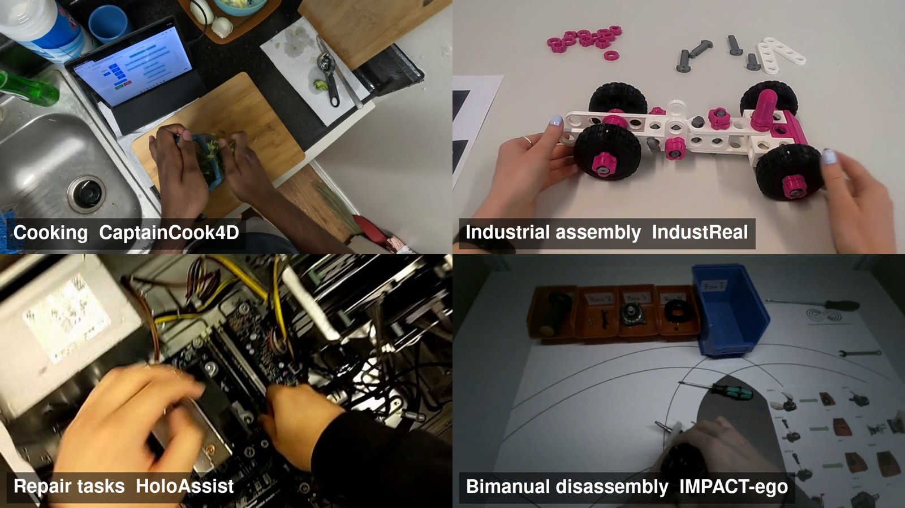
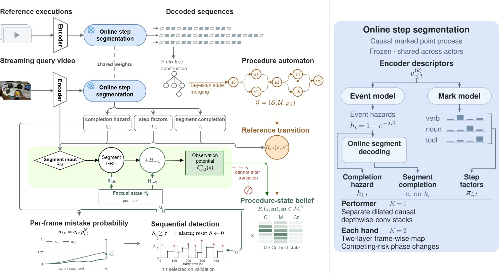
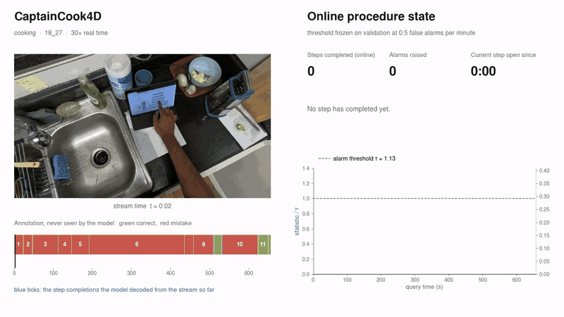
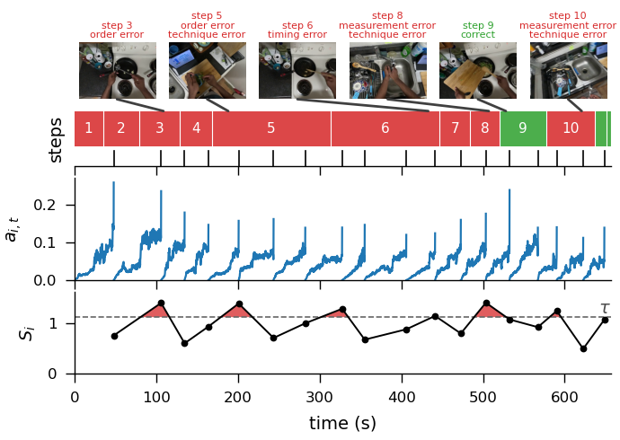

<div align="center">

# PROVIA: Procedure State Tracking for Online Mistake Detection in Egocentric Videos

[Di Wen](mailto:di.wen@kit.edu)<sup>1</sup>, Kailun Yang<sup>2</sup>, Jimmy Weissert<sup>1</sup>, Luc Maria Scherrer<sup>1</sup>, Cedric Zöllner<sup>1</sup>,
Ruiping Liu<sup>1</sup>, Yufan Chen<sup>1</sup>, Jiale Wei<sup>1</sup>, Junwei Zheng<sup>1</sup>, [Kunyu Peng](mailto:kunyu.peng@kit.edu)<sup>1,*</sup>

<sup>1</sup>Karlsruhe Institute of Technology &nbsp;&nbsp; <sup>2</sup>Hunan University &nbsp;&nbsp; <sup>*</sup>Corresponding author

[](LICENSE)
[](https://www.python.org/)
[](https://pytorch.org/)

**Official implementation of the paper "PROVIA: Procedure State Tracking for Online Mistake Detection in Egocentric Videos".**



</div>

PROVIA detects mistakes in egocentric video while a person carries out a procedure, from past frames only. The same
model runs on cooking (CaptainCook4D), industrial assembly (IndustReal), repair tasks (HoloAssist) and bimanual
disassembly (IMPACT-ego), at 58-70 frames per second on one GPU.

PROVIA is one model for a procedure carried out by *K* actors: *K* = 1 when the steps describe the person as a whole
(CaptainCook4D, IndustReal, HoloAssist), *K* = 2 when each hand carries a distinct part of the work (IMPACT-ego). One
execution status is carried per actor, and the factual state, the automaton induction and the exact filter are the same
construction in both settings. The scripts named `single_actor` and `bimanual` are these two settings of *K*, not two methods; they are
separate only because the filter for *K* = 2 is joint over both hands.

## News

- **2026-10-31**: The trained models behind Table II are available on
  [Google Drive](https://drive.google.com/open?id=1krfuCg06MLiexqqfG9FYzTl4AgOzW20h), and
  `scripts/evaluate_checkpoints.sh` scores them (see [Checkpoints](#checkpoints)).
- **2026-10-31**: Added the files that were missing from the earlier version of this repository. Every stage from
  dataset conversion to the alarm tables and the qualitative figure now has a script. If you cloned the repository
  before this date, please clone it again.

## Highlights

- **Evaluation on complete trials.** Recordings are kept at full length, so mistakes and the corrections that follow
  them occur where the person made them. Alarms are scored at a false-alarm budget whose threshold is fixed on
  validation, next to controls that use no perception.
- **What was done is kept apart from what was accepted.** A factual state remembers the steps each actor performed,
  mistakes included. An exact posterior tracks the state of a procedure automaton and the execution status of each
  actor (correct, mistake, correction). The procedure state advances only in the correct-status branch.
- **Automaton from correct demonstrations.** The procedure automaton is induced by Bayesian state merging; no mistake
  label is needed to build it.
- **One model across domains and granularities.** Steps last from under two seconds to over forty, vocabularies range
  from 39 to 2,197 step classes, and a procedure is carried out by one actor or by two hands.

## Method

<div align="center">

</div>

A causal marked point process segments the stream into steps. After every completed step the factual state is updated
and the posterior over procedure state and execution status is filtered exactly. A sequential test turns the per-frame
mistake probability into alarms.

## Demo

<div align="center">

</div>

A CaptainCook4D test recording replayed next to the online outputs. At stream time *t* the panel shows only what the
model had produced by *t*. The annotation strip (green correct, red mistake) is never seen by the model. At a budget of
0.5 false alarms per minute, six alarms cover eight of the nine mistakes in this recording.

<div align="center">

</div>

## Results

Step-level mistake detection on the test split, mean ± SD over three training seeds. All methods share the same
features and the same predicted step segments.

| Method | CaptainCook4D AP | AUROC | IndustReal AP | AUROC | HoloAssist AP | AUROC | IMPACT-ego AP | AUROC |
|---|---|---|---|---|---|---|---|---|
| Causal-TCN | .336±.007 | .527±.014 | .148±.040 | .616±.055 | .111±.012 | .633±.002 | .127±.009 | .546±.008 |
| Controlled PREGO | .330±.003 | .496±.007 | .133±.010 | .612±.008 | .057±.002 | .540±.007 | .086±.002 | .442±.006 |
| MistSense-RGB-style | .346±.006 | .522±.018 | .101±.007 | .567±.028 | .105±.009 | .625±.008 | .134±.009 | .548±.010 |
| **PROVIA** | **.364±.024** | **.554±.018** | **.153±.029** | **.625±.022** | **.131±.011** | **.670±.009** | **.147±.008** | **.567±.007** |

On HoloAssist, PROVIA recalls more mistakes than every baseline at each false-alarm budget (.034 / .124 / .210 at
0.1 / 0.5 / 1 false alarms per minute), and its alarms follow the end of the mistake within half a second.

## Contents

This repository contains the source used for the reported numbers: dataset conversion, feature extraction, the
streaming step segmentation, automaton induction, PROVIA training and test evaluation, the alarm protocol, the
controlled baselines, the ablations and the CPU streaming benchmark. The first-mistake analysis on
Assembly101-O and EPIC-Tent-O and the GPU timing are not part of this repository.

## Repository layout

| Path | Content |
|---|---|
| `provia/data/` | Dataset adapters, canonical manifests, single-actor projection and splits |
| `provia/observer/` | Online step segmentation |
| `provia/automaton/` | Procedure languages, automaton induction, step effects and prefix evidence |
| `provia/model/` | The model and the exact filter |
| `provia/training/` | Feature extraction, training and example construction |
| `provia/evaluation/` | Test evaluation, alarm protocol and streaming benchmark |
| `provia/baselines/` | Causal-TCN, Controlled PREGO and MistSense-RGB-style |
| `scripts/` | The pipeline, one script per stage: `single_actor/`, `bimanual/`, `baselines/`, `ablation/`, `alarm/`, `features/`, `figures/`; `evaluate_checkpoints.sh` scores the released models |
| `configs/data/` | Example dataset configurations (copy to `*.local.json` and fill in your paths) |
| `tests/` | Unit tests |

All commands below are run from the repository root. Manifests are written to `data/`, feature caches to `cache/`
and experiment state to `runs/`; none of these directories is versioned. `PROVIA_DEVICE` (default `cuda`) and
`PROVIA_GPUS` (default 4) select the device and the number of training processes.

## Installation

```bash
python -m venv .venv && source .venv/bin/activate
pip install -e .                 # core: numpy, torch, scikit-learn, safetensors, decord
pip install -e ".[features]"     # feature extraction and figure: opencv, ultralytics (hand detector), matplotlib
pip install -e ".[dev]" && pytest
```

The frozen frame encoder is DINOv2 ViT-S/14, loaded through `torch.hub` (`facebookresearch/dinov2`); set `TORCH_HOME`
if the hub cache is not in the default location. The hand detector for IMPACT-ego is a YOLO hand model that is not
redistributed here; `scripts/bimanual/extract_features.sh` takes the path of its weights.

## Data

Obtain the datasets from their authors: CaptainCook4D, IndustReal, HoloAssist and IMPACT (v1.1, egocentric view).
Copy the matching example configuration to `configs/data/<name>.local.json`, fill in the paths, and convert. The
pipeline reads one manifest per benchmark, `data/<dataset>.jsonl`:

```bash
# CaptainCook4D
python -m provia.data.cli convert --dataset captaincook4d --config configs/data/captaincook4d.local.json --out data/captaincook4d.all.jsonl
python -m provia.data.project_single_actor --input data/captaincook4d.all.jsonl --sample-rate-hz 8 --output data/captaincook4d.jsonl

# IndustReal: one atomic action class per step
python -m provia.data.cli convert --dataset industreal --config configs/data/industreal.local.json --out data/industreal.all.jsonl
python -m provia.data.project_single_actor --input data/industreal.all.jsonl --sample-rate-hz 8 --action-marks --output data/industreal.jsonl

# HoloAssist: a validation subset of the official training partition, the official validation partition as test split
python -m provia.data.cli convert --dataset holoassist --config configs/data/holoassist.local.json --out data/holoassist.all.jsonl
python -m provia.data.project_single_actor --input data/holoassist.all.jsonl --sample-rate-hz 8 --output data/holoassist.projected.jsonl
python -m provia.data.create_nested_selection_split --input data/holoassist.projected.jsonl --output data/holoassist.jsonl \
    --validation-fraction 0.2

# IMPACT-ego
python -m provia.data.convert_impact --release /path/to/IMPACT-v1.1/annotations --video-dir /path/to/IMPACT-v1.1/videos/ego \
    --out data/impact_public_ego --participant-disjoint
python -m provia.data.cli convert --dataset impact --config configs/data/impact_ego.local.json --out data/impact_ego.jsonl
```

Splits: CaptainCook4D and IndustReal use their official participant-disjoint splits; IMPACT-ego uses a deterministic
participant-disjoint fold (57/15/21 executions from 8/2/3 participants). Every converter records the rule it applied
in the manifest metadata.

## Reproducing the reported numbers

Each stage is one script; run them in this order. `DATASET` is `captaincook4d`, `industreal` or `holoassist`.

**Single-actor benchmarks**

```bash
scripts/single_actor/extract_features.sh DATASET train_val   # DINOv2-S/14 frame features at 8 Hz
scripts/single_actor/train_observer.sh DATASET               # step segmentation, selected by validation likelihood
scripts/single_actor/build_automaton.sh DATASET              # automaton induction, examples, prefix evidence, step effects
scripts/single_actor/train_provia.sh DATASET 0               # also seeds 1 and 2; includes validation
scripts/single_actor/extract_features.sh DATASET test        # test features, after model selection
scripts/single_actor/evaluate_test.sh DATASET                # test evaluation at the validation thresholds
```

**IMPACT-ego** (*K* = 2, open-step candidates on an in-domain hand-object stream shared by every method: hand boxes from
the hand detector, square crops at 1.6x the box, a DINOv2-S/14 fine-tuned on training-fold step labels)

```bash
scripts/bimanual/extract_features.sh /path/to/hand_detector.pt
scripts/bimanual/train_observer.sh
scripts/bimanual/build_automaton.sh
scripts/bimanual/train_provia.sh 0                           # also seeds 1 and 2
scripts/bimanual/evaluate_test.sh
```

**Baselines** (same features, seeds and predicted segments; `METHOD` is `causal_tcn`, `prego` or `mistsense_rgb`)

```bash
scripts/baselines/single_actor.sh DATASET METHOD SEED
scripts/baselines/bimanual.sh METHOD SEED
```

**Alarm protocol** (recall at 0.1 / 0.5 / 1 false alarms per minute of correct operation, recall of first and later
mistakes, alarm timing and position controls; every threshold is fixed on validation per method, seed and budget, and
the test recordings are scored once at that threshold)

```bash
scripts/alarm/run.sh
```

**Ablations**

```bash
scripts/ablation/inference.sh DATASET SEED [CHECKPOINT]      # interventions on the trained model
scripts/ablation/retrain_no_factual_history.sh DATASET SEED  # the retrained row
```

**Efficiency**: `python -m provia.launch benchmark-single` and `benchmark-bimanual` time streaming inference on CPU.

**Qualitative figure**: `scripts/figures/qualitative.py`, after the alarm protocol.

## Checkpoints

The trained models behind Table II are available on
[Google Drive](https://drive.google.com/open?id=1krfuCg06MLiexqqfG9FYzTl4AgOzW20h): for each benchmark the step
segmentation model, PROVIA for training seeds 0, 1 and 2 with its automata and step-effect laws, and for IMPACT-ego
the fine-tuned hand-object encoder. The folder's README lists the files.

With the data and features in place, one script rebuilds the inputs with the released step segmentation model and
scores the three seeds on validation and test (the results go to `runs/DATASET/model_seedN/`, where the alarm and figure
scripts read them; `scripts/ablation/inference.sh` takes a released `provia_seedN.pt` as its last argument):

```bash
scripts/evaluate_checkpoints.sh industreal /path/to/PROVIA_checkpoint/industreal
```

For IMPACT-ego, build the features with the released encoder instead of fine-tuning:
`scripts/bimanual/extract_features.sh /path/to/hand_detector.pt /path/to/PROVIA_checkpoint/impact_ego/hand_object_encoder.pth`.
Scores of a single seed can differ in the fourth decimal across machines; the means over the three seeds match the paper.

## Evaluation protocol

Correct executions come from the training split only.  The step segmentation model, the automata, the PROVIA
checkpoints and every threshold are selected on the validation split.  Test features are extracted after model
selection, and each test recording is evaluated once at the validation thresholds.  The evaluators check split
metadata and that each input belongs to the examples it is used with, and stop on inputs that do not match.

## Citation

```bibtex
@article{wen2026provia,
  title   = {PROVIA: Procedure State Tracking for Online Mistake Detection in Egocentric Videos},
  author  = {Wen, Di and Yang, Kailun and Weissert, Jimmy and Scherrer, Luc Maria and Z{\"o}llner, Cedric and Liu, Ruiping and Chen, Yufan and Wei, Jiale and Zheng, Junwei and Peng, Kunyu},
  journal = {arXiv preprint},
  year    = {2026}
}
```

## Acknowledgments

The project is funded by the Deutsche Forschungsgemeinschaft (DFG, German Research Foundation), SFB-1574, 471687386,
and was supported in part by the SmartAge project sponsored by the Carl Zeiss Stiftung (P2019-01-003; 2021-2026).
Computing time was provided on the high-performance computer HoreKa by the National High-Performance Computing Center
at KIT (NHR@KIT). We thank the authors of CaptainCook4D, IndustReal, HoloAssist and IMPACT for their datasets, and the
authors of DINOv2, PREGO, MiniROAD and MistSense for their models and code.

## License

MIT (see `LICENSE`) for the source code. The datasets keep their own licenses and are not redistributed here.
The images in `assets/` contain frames from CaptainCook4D, IndustReal, HoloAssist and IMPACT and remain under the
licenses of those datasets.
